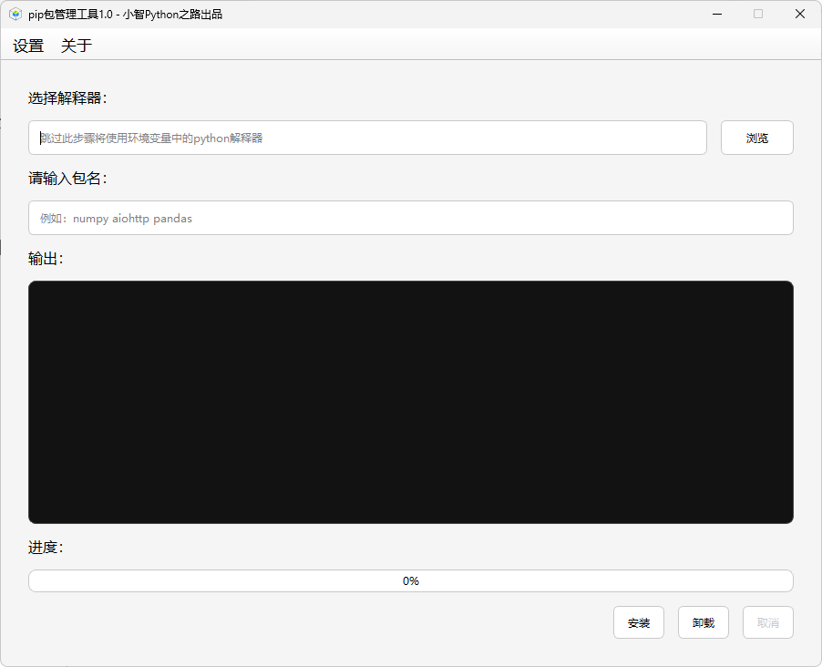
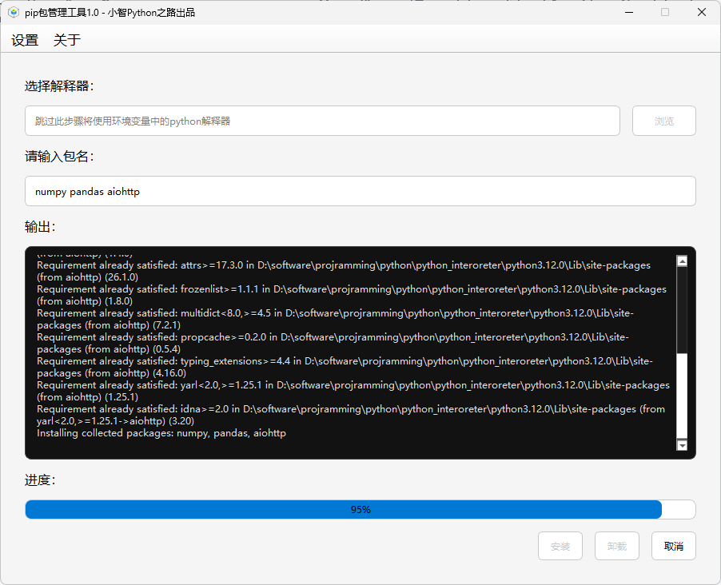
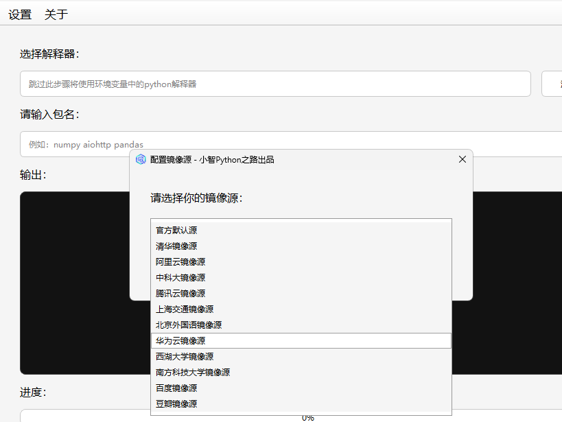

# pip-manager 2026-11-19-Update:1.0

### 系统平台：
### 平台：Windows 10 22H2 或者 Windows 11 25H2及以上

---

&emsp;&emsp;这是一个基于PyQt6的图形化Python语言写的pip包管理工具，可以让用户小白，新手等更容易熟悉pip，安装、卸载你的包，我的介绍完毕，接下来你就可以使用了！  

---
### 工具界面：


### 一、使用方式：
1、选择解释器：  
&emsp;&emsp;用户可以默认跳过此选项，跳过选项将会使用环境变量中激活的Python解释器，如果你选择了指定的解释器，那么安装/卸载的时候将使用选择的解释器，默认环境变量激活的。   

2、安装/卸载过程：  
&emsp;&emsp;在你进行之前，你需要输入你的包名，如psutil wmi等等，你也可以输入对应的版本号，如：```numpy>=1.26.4```这样的格式等！只要是pip支持的格式可以，中文除外，输入好之后
你可以执行安装或者卸载指令，工具开始工作！ 



### 二、配置镜像站：   
&emsp;&emsp;温馨提示：如果你在非中国的国外，那么你可以无需配置镜像站，因为我们默认走python官方默认源！    
&emsp;&emsp;如果你需要配置镜像站，你可以通过打开设置菜单 -> 配置镜像站，在下拉的菜单中选择对应的镜像站即可，比如：腾讯云镜像源！     

  

### 三、通过配置 -> 配置镜像站：
&emsp;&emsp;当你配置好之后，会在目录下生成一个名字为```setting_pypi.json```的文件，里面是你存放的配置文件，方便工具下次重启用于读取配置的镜像站，第一次是没有，你也可以通过在
工具的目录跟下新建一个名字为```setting_pypi.json```的文件，然后在里面输入：
```json
{
    "mirror_name": "阿里云镜像源", <--这里是工具支持的镜像站名称
    "mirror_url": "https://mirrors.aliyun.com/pypi/simple" <--对应的镜像站地址
}
```
### 国外用户可使用官方默认源，国内用户可支持国内镜像站，工具支持的有：清华、阿里云、中科大、腾讯云、上海交通、北京外国语、华为云、西湖大学、南方科技大学、百度、豆瓣

## 如果你在使用的过程中遇到任何问题，你都可以随时联系我们，我们会给你一个完整的回答！

